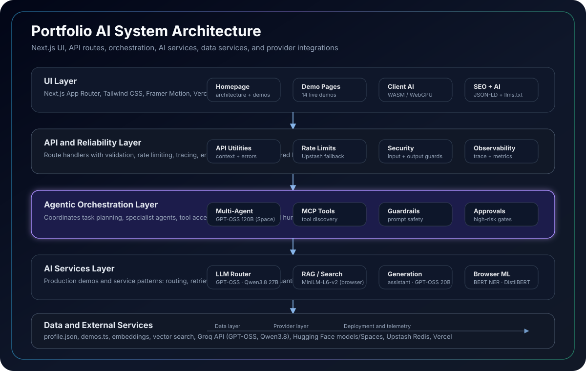

# Prasad Kavuri — Head of AI Platform & Agentic Solutions

**prasadkavuri.com** · [LinkedIn](https://linkedin.com/in/pkavuri) · vbkpkavuri@gmail.com

> Production AI platform portfolio: 10 core platform demos + 4 labs, all live. Built for VP / Head-level evaluation.

---

## 👋 For Recruiters & Hiring Managers

**Start here → [prasadkavuri.com/for-recruiters](https://www.prasadkavuri.com/for-recruiters)**

| Step | Link | Time |
|------|------|------|
| 1. Capability map | [prasadkavuri.com/capabilities](https://www.prasadkavuri.com/capabilities) | 30 sec |
| 2. Flagship demo | [Governed Agent Platform](https://www.prasadkavuri.com/demos/governed-agent-platform) | 90 sec |
| 3. Governance controls | [prasadkavuri.com/governance](https://www.prasadkavuri.com/governance) | 45 sec |
| 4. Book a conversation | [calendly.com/vbkpkavuri](https://calendly.com/vbkpkavuri) | 30 sec |

---

## About

**Prasad Kavuri** — Head of AI Platform & Agentic Solutions (at Zip) with 20+ years building
production AI platforms at enterprise scale.

| Metric | Result |
|--------|--------|
| Engineers led | 200+ across Krutrim, Ola & HERE Technologies |
| Infrastructure cost reduction | 70% at Ola (cloud-native overhaul; 13K+ B2B customers) |
| Revenue launched | $10M+ (Krutrim AI / Kruti.ai, 0 → production) |
| Production AI platform | India's first agentic AI platform |
| Experience | 20+ years, AI/ML → Agentic AI |

Chicago area & remote.

---

## Live Portfolio

**[prasadkavuri.com](https://www.prasadkavuri.com)** — 14 live AI demos (10 core platform + 4 labs)
running on shared governance infrastructure: guardrails, observability,
evaluation, and drift monitoring at the platform layer.

### Demo highlights

| Demo | Category | Signal |
|------|----------|--------|
| [Governed Agent Platform](https://www.prasadkavuri.com/demos/governed-agent-platform) | Flagship | A2A v1.0 agent + MCP server, tool gateway, approval, trajectory-eval release gate |
| [AI Evaluation Showcase](https://www.prasadkavuri.com/demos/evaluation-showcase) | Evaluation | Rubric-scored evals, release gating, CI eval suites |
| [Multi-Agent System](https://www.prasadkavuri.com/demos/multi-agent) | Agentic | GPT-OSS 120B agents on Groq, server-enforced release approval, audit trails |
| [RAG Pipeline](https://www.prasadkavuri.com/demos/rag-pipeline) | Infrastructure | Transformers.js embeddings, in-browser retrieval, citations |
| [LLM Router](https://www.prasadkavuri.com/demos/llm-router) | FinOps | Routing across GPT-OSS 20B / 120B and Qwen3.8 27B, live cost/latency tradeoffs |
| [Enterprise Control Plane](https://www.prasadkavuri.com/demos/enterprise-control-plane) | Governance | RBAC, spend limits, structured observability |
| [Edge Agent Collaboration](https://www.prasadkavuri.com/demos/edge-agent-collaboration) | Privacy-first | Browser BERT NER (names) plus regex redaction, HITL gate, sovereign AI |

---

## Stack

Next.js 16 · React 19 · TypeScript 6 · Tailwind CSS 4 · Transformers.js ·
Vercel · Upstash Redis · Groq · Playwright · Vitest

### Models

Open-weight models only, no paid proprietary models. Server model ids, tiers and fallback chains live in one file,
`src/lib/groq-models.ts`; a weekly workflow (`model-health.yml`) checks they still answer on Groq.

| Where | Model | Used for |
|---|---|---|
| Groq | `openai/gpt-oss-20b` (fast tier) | Portfolio assistant; simple queries in the router |
| Groq | `openai/gpt-oss-120b` (capable tier) | Storm research, MCP demo, generative UI, edge-agent summary; capable tier in the router |
| Groq (preview) | `qwen/qwen3.8-27b` (code tier) | Code-tier routing, falls back to GPT-OSS if unavailable |
| Hugging Face Space | `openai/gpt-oss-120b` via Groq | Multi-agent demo backend (FastAPI) |
| Browser (WASM) | `Xenova/all-MiniLM-L6-v2` | RAG pipeline embeddings |
| Browser (WASM) | `Xenova/bert-base-NER` | Edge-agent name redaction |
| Browser (WASM) | `Xenova/distilbert-base-uncased-finetuned-sst-2-english` | Quantization benchmark (FP32 vs INT8) |

Why these and not newer ones: see `specs/0029-groq-model-migration.md` and `specs/0039-browser-model-trial.md`.

**Quality baseline:** Vitest unit/integration/eval suites · npm audit, gitleaks, semgrep · 0 lint errors · CI: lint → unit → build → E2E matrix

---

## Architecture

Full architecture: [ARCHITECTURE.md](./docs/ARCHITECTURE.md) · Security: [SECURITY.md](./SECURITY.md)

---

## Machine-Readable Identity

| File | Purpose |
|------|---------|
| [/llms.txt](https://www.prasadkavuri.com/llms.txt) | Fast-parse AI agent identity |
| [/llms-full.txt](https://www.prasadkavuri.com/llms-full.txt) | Full capability context |
| [/ai-profile.json](https://www.prasadkavuri.com/ai-profile.json) | Structured identity |
| [/.well-known/agent-card.json](https://www.prasadkavuri.com/.well-known/agent-card.json) | A2A v1.0 Agent Card |
| [/api/mcp](https://www.prasadkavuri.com/api/mcp) | MCP server (Streamable HTTP) |
| [/about](https://www.prasadkavuri.com/about) | Canonical entity profile + JSON-LD |

---

*Chicago area & remote*  
*Contact: vbkpkavuri@gmail.com · [LinkedIn](https://linkedin.com/in/pkavuri) · [Book a call](https://calendly.com/vbkpkavuri)*
